# Quran Madina Html (no-images)

[](https://www.npmjs.com/package/quran-madina-html)
[](https://opensource.org/licenses/ISC)
[](https://github.com/tarekeldeeb/quran-madina-html/actions/workflows/github-code-scanning/codeql)
[](https://github.com/tarekeldeeb/quran-madina-html/actions/workflows/pylint.yml)
[](https://github.com/tarekeldeeb/quran-madina-html/actions/workflows/py_test.yml)
[](https://github.com/tarekeldeeb/quran-madina-html/actions/workflows/npm-grunt.yml)
[](https://socket.dev/npm/package/quran-madina-html)

A Quran renderer for the browser that looks like the printed Madina Mushaf — **without a single image**.
Every glyph is real, selectable, copy-pasteable text laid out with pure HTML/CSS, wrapped in one custom
element:

```html
<quran-madina-html sura="2" aya="255"></quran-madina-html>
```

**[See it live →](https://tarekeldeeb.github.io/quran-madina-html/demo/index.html)** (view the page source too —
GitHub strips `<script>` tags from this README, so the tag can't render *here*, but it's just as simple as
the snippet above once it's on your own page.)

## Why

* **Pixel-faithful to the printed Madina Mushaf** — same line breaks, same justification, same page layout.
* **Pure HTML/CSS, no images** — text stays selectable, searchable, and copy-pasteable; pages load fast.
* **One HTML tag** — no build step, no framework required.
* **Three layouts** — the 1441H and 1405H Madina prints and the 15-line IndoPak, at any font size.
* **Word-level addressing** — render any word range, even across ayas, pages, and suras.

## New in 2.0: lines justified like the print

Version 2 stretches the **letters themselves** (kashida strokes and wider letter forms, the way a
calligrapher fills a line) instead of inserting tatweel characters or squashing whole lines. It
uses the [DigitalKhatt](https://github.com/DigitalKhatt/digitalkhatt.org) fonts by Amine Anane
(OFL), with HarfBuzz deciding every stretch at build time; the browser only needs the font and
one `font-feature-settings` per word. The text is still real, selectable text.

Three layouts, picked with `data-layout` on the script tag:

<table>
<tr>
<td align="center">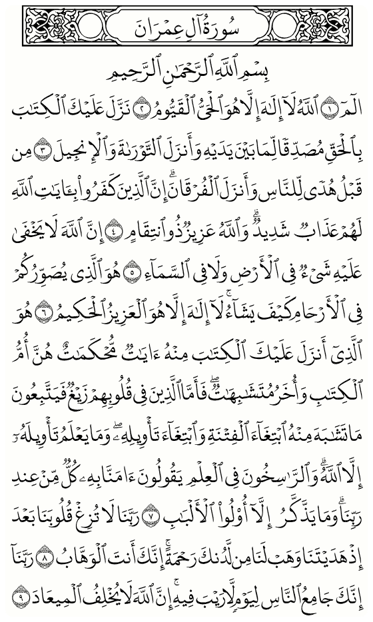<br/><code>1441H</code> (default)<br/>New Madina Mushaf</td>
<td align="center">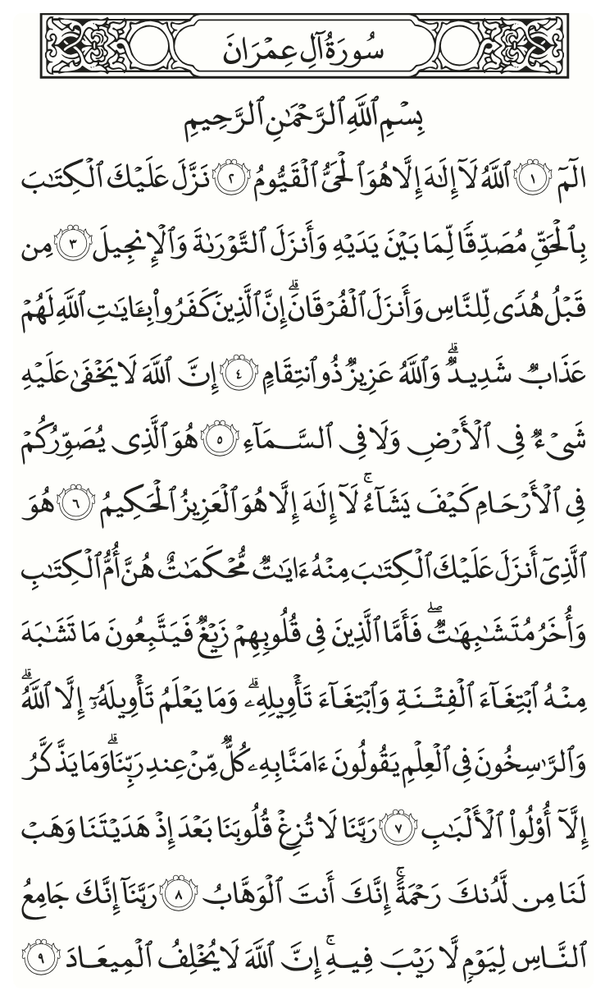<br/><code>1405H</code><br/>Old Madina Mushaf (v1's layout)</td>
<td align="center">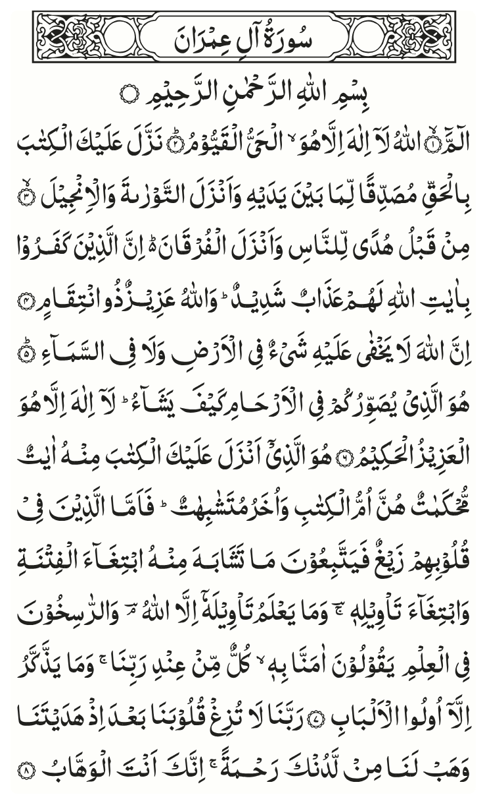<br/><code>IndoPak</code><br/>15-line IndoPak</td>
</tr>
</table>

```html
<script src="https://unpkg.com/quran-madina-html" data-layout="1441H" data-font-size="22"></script>
<quran-madina-html page="50"></quran-madina-html>
```

| | `1441H` | `1405H` | `IndoPak` |
|---|---|---|---|
| Font | DigitalKhatt New Madina | DigitalKhatt Old Madina | DigitalKhatt IndoPak |
| Text | [Tanzil](https://tanzil.net) Uthmani; pause marks of the 1441H print | Tanzil Uthmani | DigitalKhatt's IndoPak text (IndoPak spelling) |
| Line breaks | the 1441H print (King Fahd Complex page data) | the 1405H print (same as v1) | DigitalKhatt's IndoPak layout |
| Pages | 604 | 604 | 610 |

* Everything else works the same in every layout: `page`, `sura`/`aya`, `words`, `highlight`,
  `error`, `headless`, `notitle`, copy and translate. `sura`/`aya` always use the Kufan
  numbering, so the same attributes show the same verse in every layout.
* Any font size: the v2 databases are in em, so `data-font-size` just scales the page.
* Spacing follows the print: words keep the print's ink-to-ink gaps, loose lines stretch
  letters, dense lines narrow their words (never the aya numbers). See
  [`docs/v2`](docs/v2/design-decisions.md) for how it was measured against the print.
* **Drop-in upgrade:** every tag renders with v2, no code changes needed. `data-font` and
  `data-name` are ignored since 2.0 (a console warning says so); pick a layout with
  `data-layout` instead. The v1 font databases are no longer shipped in the npm package — pin
  `quran-madina-html@1` if you need them.

## History: the 1.x renderer

Version 1 inserted tatweels and scaled whole lines to fit. Page 106, rendered by 1.x next to a
scan of the actual printed page:

<table>
<tr>
<td align="center"><br/>Printed Madina Mushaf</td>
<td align="center">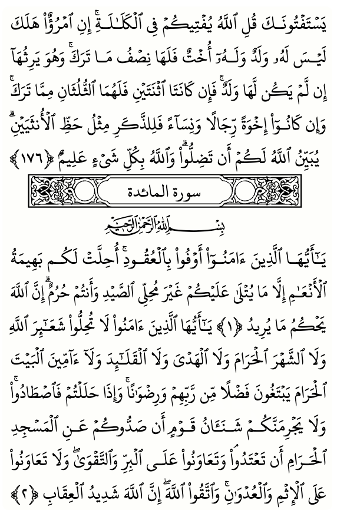<br/><code>&lt;quran-madina-html page="106" headless="true"&gt;</code></td>
</tr>
</table>

1.x supported several fonts through `data-font` — `Hafs`, `Uthman`, `Amiri Quran`,
`Amiri Quran Colored` (tajweed rules color-coded) and `me_quran`:

<table>
<tr>
<td align="center"><br/>Hafs</td>
<td align="center">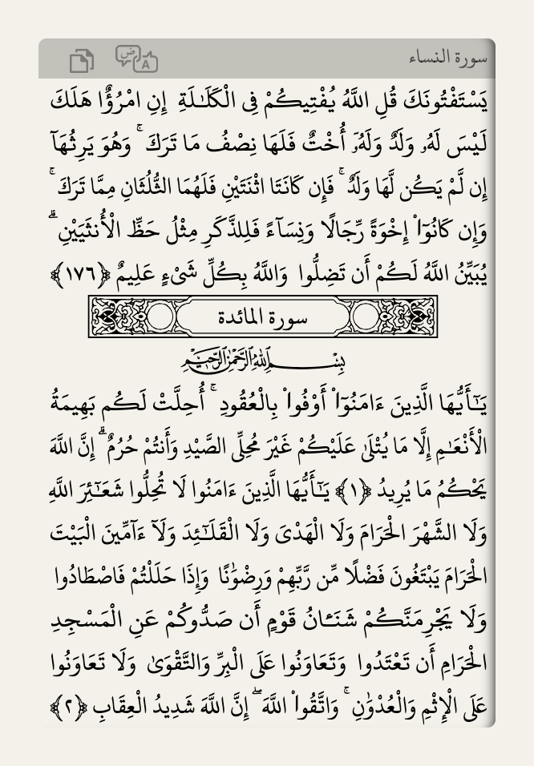<br/>Uthman</td>
<td align="center">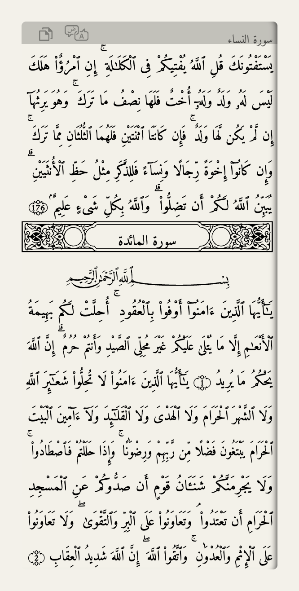<br/>Amiri Quran</td>
</tr>
<tr>
<td align="center">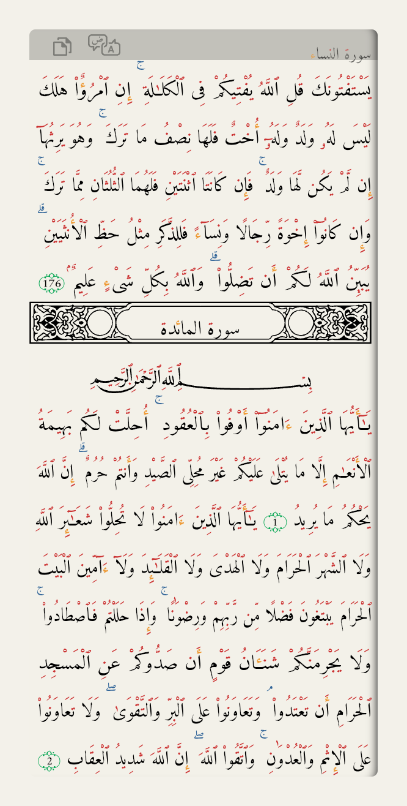<br/>Amiri Quran Colored</td>
<td align="center">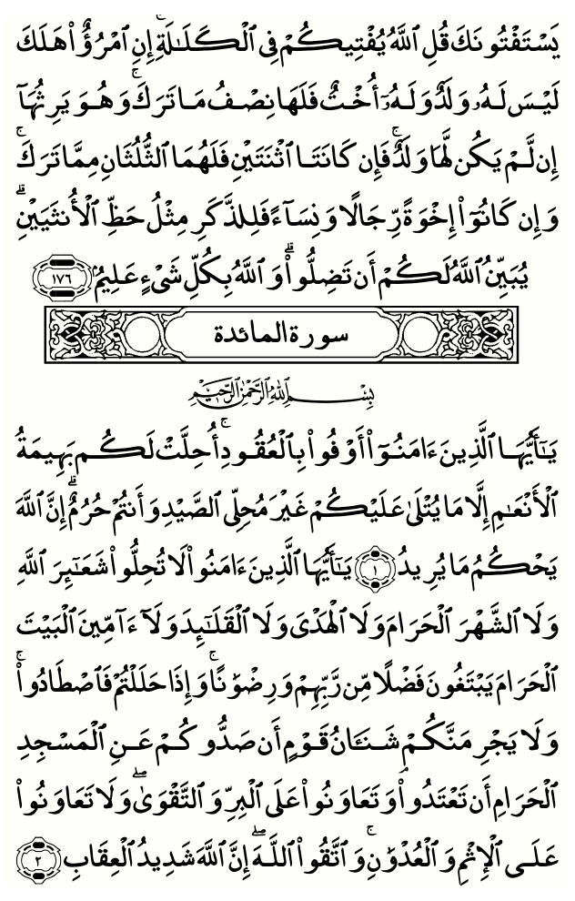<br/>me_quran</td>
<td></td>
</tr>
</table>

## Features

### Verse ranges — framed or frameless

`sura`/`aya` renders just the ayat you ask for, laid out exactly as they sit on the Madina page.
By default you get a header (sura name + copy/translate icons); add `headless="true"` to strip
that chrome and keep only the Quran text:

<table>
<tr>
<td align="center">

```html
<quran-madina-html sura="5" aya="1-2">
</quran-madina-html>
```

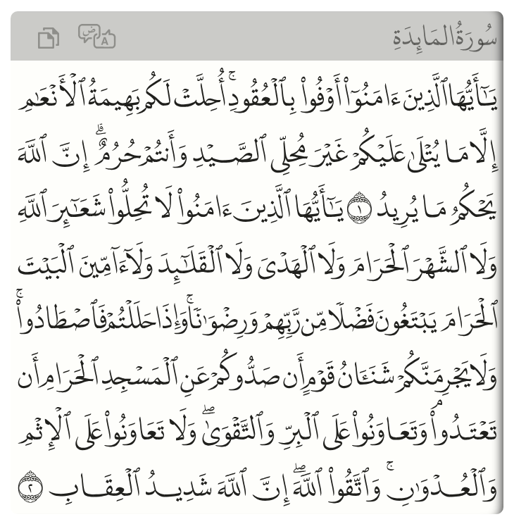
</td>
<td align="center">

```html
<quran-madina-html sura="5" aya="1-2"
  headless="true">
</quran-madina-html>
```

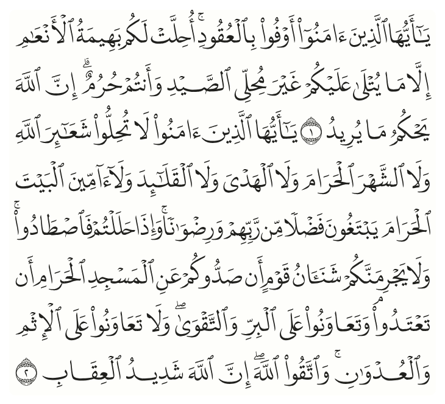
</td>
</tr>
</table>

### Word-level selection

The `words` attribute picks out a word range — 1-based, inclusive — and hides the rest of the
text *in place*, so the original Madina line justification is preserved instead of being
reflowed. Counting continues past the end of the given aya, so a selection can cross aya, page,
and even sura boundaries:

<table>
<tr>
<td align="center">

```html
<quran-madina-html sura="1" aya="1"
  words="1:2">
</quran-madina-html>
```

first two words of Al-Fatiha; the dashed
outline marks the hidden remainder of the line
<br/><br/>
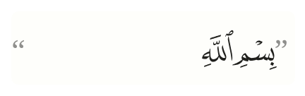
</td>
<td align="center">

```html
<quran-madina-html sura="1" aya="7"
  words="1-14">
</quran-madina-html>
```

words 1-14 counted from Al-Fatiha's last aya
spill into Surat Al-Baqara — its basmala
counts as words 10-13
<br/><br/>
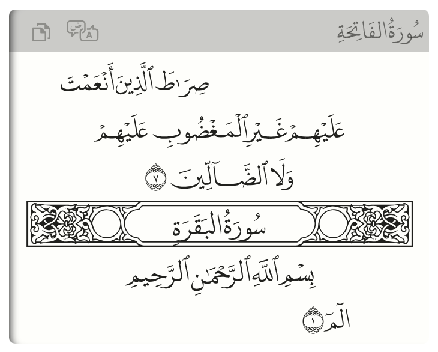
</td>
</tr>
</table>

### Highlighting words

`highlight` (soft yellow) and `error` (soft red) mark a word range — same 1-based, inclusive
format as `words` — on top of whatever is being shown. Unlike `words`, they work with or without
a `words` selection, and even on a full `page` render:

```html
<quran-madina-html sura="1" aya="1" highlight="2-3"></quran-madina-html>
```

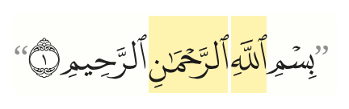

## Getting Started

### Installation

Install via **npm**:

```bash
npm install quran-madina-html
```

Or include directly via **CDN script tag** in your HTML `<head>`:

```html
<script type="text/javascript" src="https://unpkg.com/quran-madina-html"></script>
```

* ``data-layout``: ``1441H`` (default), ``1405H``, ``IndoPak`` — see *New in 2.0* above
* ``data-font-size`` defaults to 16 (px); any size works
* ``data-font`` / ``data-name``: ignored since 2.0 (a console warning is logged)

Then in your body, just add the tag.

```html
<quran-madina-html sura="2" aya="8-10"></quran-madina-html>
```

If the selected aya(s) fit on a single line, the default is to generate an inline ``<span>`` element, otherwise a ``<div>`` is generated.

You can also restrict the output to a specific word sequence with the ``words`` attribute (1-based, inclusive; ``start-end``, ``start:end`` or a single ``index``). Word indices are counted starting from the given ``sura``/``aya`` and may run past it, so the rendered selection can span multiple ayas — and even cross page and sura boundaries. The **basmala counts as 4 real, individually selectable words** — matching the flat Tanzil word indexing most consumers count against (At-Tawba has none; Al-Fatiha's basmala is its real aya 1). This holds both when the selection crosses into a new sura and when it is **anchored at a sura's aya 1** (word 1 is then بسم and word 5 the aya's first word), while the **sura title** stays uncounted decoration, shown for context only. Display follows the printed Mushaf: when **all 4** basmala words fall inside the selection (or on a full ``page`` render) they show as the traditional **﷽ ligature**; a partial selection (1–3 of the 4) renders the individual words. Either way the basmala occupies 4 word indices. The non-selected words are kept in place so the original Madina line layout is preserved — only the chosen words are shown. Aya-number markers are not counted.

> **Changed in 0.9.0:** the basmala used to be a *never counted* decoration; a cross-sura ``words``
> index now lands 4 words later than in 0.8.x.
>
> **Changed in 0.9.3:** a ``words`` walk anchored at a sura's aya 1 now counts that sura's own
> basmala too (0.9.0–0.9.2 only counted *crossed-into* basmalas, so aya-1-anchored word indices
> landed 4 words early relative to the Tanzil flat indexing).
>
> **Changed in 0.9.5:** a ``words`` walk that runs past the end of An-Nas now **wraps around to
> Al-Fatiha** and keeps counting (previously it stopped, silently truncating the selection);
> Al-Fatiha's title stays uncounted decoration, and its basmala — being its real aya 1 —
> renders as normal aya words.

```html
<quran-madina-html sura="1" aya="1" words="1:2"></quran-madina-html>  <!-- first two words only -->
<quran-madina-html sura="1" aya="1" words="3-10"></quran-madina-html> <!-- words 3..10, spanning ayas 1-3 -->
<quran-madina-html sura="1" aya="7" words="1-14"></quran-madina-html> <!-- spans Al-Fatiha into Al-Baqara:
                                                                           9 words + 4 basmala words + الٓمٓ -->
```

The ``words`` attribute is ignored when rendering a full ``page``.

To embed a selection inside your own chrome (e.g. a quiz that already labels the sura/aya), the ``notitle`` attribute hides the crossed-into sura's **name text** while keeping its decorated title line (the ornamental frame stays, empty) — and the basmala, being real counted words, still renders:

```html
<quran-madina-html sura="1" aya="7" words="1-14" notitle="true"></quran-madina-html>
```

#### Highlighting and marking words

Two more range attributes lay a visual mark over a sub-range of whatever is being shown —
``highlight`` (soft yellow) and ``error`` (soft red) — using the same 1-based, inclusive range
format as ``words`` (``start-end``, ``start:end``, or a single index). Unlike ``words``, they
work in **every** render mode: alongside a ``words`` selection, on a plain ``sura``/``aya`` verse
(counted from that aya's first word), and even on a full ``page`` render (counted from the
page's first aya — a page never starts mid-aya, so this is always well-defined). A range must
fall entirely within whatever is actually displayed (the ``words`` selection if one is set,
otherwise the whole verse/page); an out-of-range or malformed value is ignored with a console
warning rather than breaking the render. When ``highlight`` and ``error`` overlap on the same
word, ``error`` wins.

```html
<quran-madina-html sura="1" aya="7" words="1-14" highlight="10-13" error="1-2"></quran-madina-html>
<quran-madina-html sura="2" aya="255" highlight="5-8"></quran-madina-html> <!-- no words needed -->
<quran-madina-html page="2" error="1-4"></quran-madina-html> <!-- counted from the page's first aya -->
```

Colors come from the ``--qmh-highlight``/``--qmh-error`` CSS custom properties on
``quran-madina-html`` (defaults: soft yellow/soft red) — override them, or the
``.quran-madina-html-word-highlight``/``.quran-madina-html-word-error`` classes directly, from
your own stylesheet.

Another option exists to render a complete quran page:

```html
<quran-madina-html page="106"></quran-madina-html>
```

By default a multiline render gets a header (sura name + copy/translate icons); clicking any aya (inline or multiline) opens a small copy/translate popup scoped to it. Set ``headless="true"`` to drop the header and render only the Quran text:

```html
<quran-madina-html sura="2" aya="8-10" headless="true"></quran-madina-html> <!-- no header -->
```

### Attributes Reference

| Attribute | Type | Default | Description |
|---|---|---|---|
| `sura` | `number \| string` | - | Sura number (1–114). Required when using `aya`. |
| `aya` | `number \| string` | - | Single aya or verse range (e.g., `255`, `"8-10"`). |
| `page` | `number \| string` | - | Full Mushaf page number (1–604; IndoPak 1–610). Mutually exclusive with `sura`/`aya`. |
| `words` | `string` | - | 1-based word index or range (e.g., `"1:2"`, `"3-10"`, or single index `"5"`). |
| `highlight` | `string` | - | 1-based word range to mark soft yellow (same format as `words`). Works with or without `words`, and with `page` too. |
| `error` | `string` | - | 1-based word range to mark soft red (same format as `words`). Wins over `highlight` on overlap. |
| `headless` | `boolean \| string` | `false` | Set to `"true"` to remove top sura header chrome and copy/translate icons. |
| `notitle` | `boolean \| string` | `false` | Set to `"true"` to hide sura name text while retaining title frame decoration. |
| `data-layout` | `string` | `"1441H"` | Layout: `1441H`, `1405H`, `IndoPak`. |
| `data-font-size` | `number \| string` | `16` | Font size in px; any size. |
| `data-font`, `data-name` | `string` | - | Ignored since 2.0 (logs a warning). |
| `data-cdn` | `string` | unpkg | Base URL for the CSS and databases (self-hosting, offline apps). |

## React wrapper

For React apps (web, or mobile via a Capacitor WebView), use
[`@tarekeldeeb/quran-madina-react`](https://www.npmjs.com/package/@tarekeldeeb/quran-madina-react),
a thin component wrapping the `<quran-madina-html>` tag — lives in this repo's [`react/`](react)
folder and is released in lockstep with this package.

```bash
npm install @tarekeldeeb/quran-madina-react react
```

```jsx
import QuranMadinaHtml from "@tarekeldeeb/quran-madina-react";

<QuranMadinaHtml page={106} layout="1441H" />
```

See [`react/README.md`](react/README.md) for the full prop reference and the Capacitor
(iOS/Android) packaging guide.

## Dev Setup

The project is published on npm ``npm install quran-madina-html``, with sources, assets and distributables.
Alternatively, you can fork this repo, then clone it.

```bash
apt install python3-distutils nodejs npm chromium-driver
npm install // install components and scripts
npm run release // build the dist with dependencies

```

(`npm run build-db` still rebuilds the 1.x databases in `assets/db/`; the runtime no longer reads them.)

The databases (`assets/db/v2`) are built from the Tanzil text and a checkout of
[digitalkhatt.org](https://github.com/DigitalKhatt/digitalkhatt.org) (fonts and layouts):

```bash
python src/db/v2/build_v2.py --layout 1441H --tanzil quran-uthmani.txt --dk-src ../digitalkhatt.org/ClientApp/src
python src/db/v2/build_v2.py --layout 1405H --tanzil quran-uthmani.txt --dk-src ../digitalkhatt.org/ClientApp/src
python src/db/v2/build_v2.py --layout IndoPak --dk-src ../digitalkhatt.org/ClientApp/src
for db in Madina-1441H Madina-1405H IndoPak-15; do python src/db/shard_db.py assets/db/v2/$db.json assets/db/v2; done
python src/db/v2/check_v2_db.py assets/db/v2/Madina-1441H.json
```

Download the Tanzil text as *Uthmani*, with pause marks, sajda and rub-el-hizb signs.

## Credits

* Quran text: [Tanzil Project](https://tanzil.net) (Uthmani 1.1).
* v2 fonts and the 1405H/IndoPak layouts: [DigitalKhatt](https://github.com/DigitalKhatt/digitalkhatt.org)
  by Amine Anane, sponsored by Tarteel (fonts OFL 1.1, code MIT). The fonts in `assets/db/v2` are
  modified copies (stretch-position features added) under the same license, renamed `QMH ...`.
* 1441H line breaks: King Fahd Glorious Quran Printing Complex page data, as published in the
  [`quran-qcf4`](https://www.npmjs.com/package/quran-qcf4) package (data under MIT); only line
  boundaries are used.

## Demo

<https://tarekeldeeb.github.io/quran-madina-html/demo/index.html>

Don't forget to see the page source!

