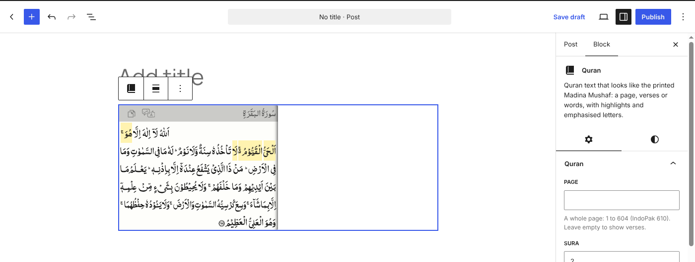
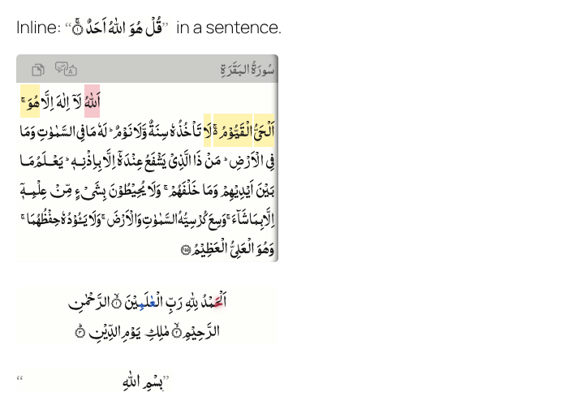

# WordPress

The **Quran Madina Html** plugin adds a Quran block and a `[quran]` shortcode to any WordPress
site. No code needed.



## Install

1. Download the plugin:
   [quran-madina-html-wordpress.zip](https://github.com/tarekeldeeb/quran-madina-html/releases/latest/download/quran-madina-html-wordpress.zip)
   (from the latest GitHub release).
2. In WordPress, go to **Plugins → Add New Plugin → Upload Plugin**, choose the zip, and
   **Install Now**.
3. **Activate** it.

It needs WordPress 6.3 or later and PHP 7.4 or later.

## The Quran block

Add a **Quran** block (search for "Quran" or "قرآن" in the block inserter). Set it in the
block sidebar:

| Setting | Example | Shows |
|---|---|---|
| Page | `50` | a whole page; leave empty to show verses |
| Sura and Verses | `2` and `255`, or `2` and `8-10` | those verses |
| Only these words | `1-5` | only some words, counted from the first verse |
| Highlight | `5-8` | words marked yellow |
| Mistake | `3` | words marked red |
| Letters | `1:3, 4:3-5 emerald blink` | emphasised letters ([format](../guide/letters.md)) |
| Hide the header | on | only the Quran text, without the sura name, copy and translate |

The text shows live in the editor as you change them.

## The shortcode

In any post, page or text widget:

```text
[quran sura="2" aya="255"]
[quran page="1"]
[quran sura="2" aya="255" highlight="5-8" error="1"]
[quran sura="1" aya="2-4" letters="1:3, 4:3-5 emerald blink"]
[quran sura="1" aya="1" words="1-2"]
[quran sura="5" aya="1-2" headless="true"]
```

It takes every [tag attribute](../reference/attributes.md): `page`, `sura`, `aya`, `words`,
`highlight`, `error`, `letters`, `headless`, `notitle`, `quotes`, `inline`. A verse that fits
on one line shows inline, inside the sentence:



`[quran_madina ...]` works too, in case another plugin already uses `[quran]`.

## Settings

Under **Settings → Quran Madina**:

- **Print:** the 1441H or 1405H Madina Mushaf, or the 15-line IndoPak. One print for the
  whole site.
- **Font size:** in pixels, 16 by default.

The plugin carries the library, the Quran text and the fonts for all three prints, and loads
them from your own site: nothing comes from unpkg.com or any other outside server. (Versions
2.1.1 to 2.1.3 loaded from unpkg.com unless you copied the library to the site.)

## Notes

- The library loads only on pages that show Quran text.
- Light and dark themes are detected from your theme's text colour; see
  [Styling and dark mode](../guide/styling.md). Your theme's CSS can change the colours with the
  [custom properties](../reference/css.md).
- Caching and optimisation plugins: exclude the `quran-madina-html` script from "combine" or
  "defer" options if the text doesn't appear. The library reads its settings from its own
  script tag.
- Uninstalling the plugin removes its settings, and the copy of the library that versions
  2.1.1 to 2.1.3 could save in the uploads folder.

## License

The plugin, including its copy of the library, is dual licensed: GPLv2 or later, or the
["Waqf" General Public License 2.0](https://github.com/ojuba-org/waqf/tree/master/2.0), at your
choice (see `LICENSE.txt` in the plugin folder). The GPL option is for WordPress.org, whose
plugins must be GPL compatible. Outside the plugin, this project stays under the Waqf General
Public License 2.0 only. The fonts are under the SIL Open Font License 1.1, and the Quran text
is the Tanzil Project's (Creative Commons Attribution 3.0, distributed verbatim).

## Building the plugin

`wordpress/build.sh` copies the library into the plugin's `library/` folder (run `npx grunt`
first); `wordpress/build.sh --zip quran-madina-html.zip` also writes the zip. CI does this and
runs WordPress.org's [Plugin Check](https://wordpress.org/plugins/plugin-check/) on the result.
