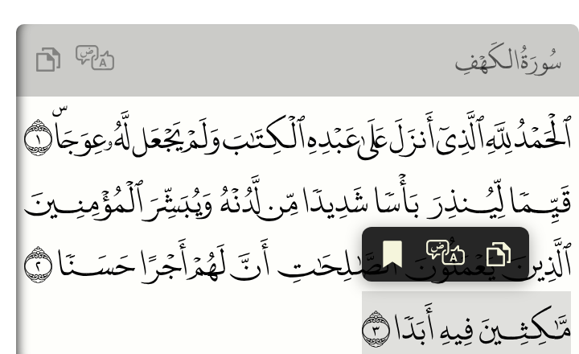

# Verse actions

Clicking a verse opens a small popup over it. By default it has two buttons: **copy** the verse
and **translate**, which opens the verse on quran.com. Those are the built-in *verse actions*:
you can choose which ones each tag offers, add your own, or remove them all. *New in 2.2.*

Actions are registered once for the whole page and are offered by every tag on it, unless a
tag's `actions` attribute picks a subset.

## Choosing actions per tag

`actions` lists the action ids a tag offers. `none` turns them all off: the verses are then
plain text, with no hover highlight, no pointer and no popup. It also hides the copy and
translate icons in the header (on multi-line renders).

=== "HTML"

    ```html
    <quran-madina-html sura="2" aya="255" actions="copy"></quran-madina-html>
    <quran-madina-html sura="2" aya="255" actions="none"></quran-madina-html>
    ```

=== "React"

    ```jsx
    <QuranMadinaHtml sura={2} aya="255" actions={["copy"]} />
    <QuranMadinaHtml sura={2} aya="255" actions={[]} />
    ```

=== "React Native"

    ```jsx
    <QuranMadinaNative sura={2} aya="255" actions={["copy"]} />
    <QuranMadinaNative sura={2} aya="255" actions={[]} />
    ```

=== "Flutter"

    ```dart
    QuranMadinaFlutter(sura: 2, aya: '255', actions: ['copy'])
    QuranMadinaFlutter(sura: 2, aya: '255', actions: [])
    ```

=== "WordPress"

    ```text
    [quran sura="2" aya="255" actions="copy"]
    [quran sura="2" aya="255" actions="none"]
    ```

    In the Quran block, the same goes in **Verse actions**.

Without the attribute, a tag offers every registered action. A verse with no action left is
plain text, whatever the reason: `actions="none"`, every action removed, or every action's
[`when`](#only-on-some-verses) saying no.

## Your own action: bookmarks

An action is an id, a title, an icon, and a function to run. This one saves the clicked verse
in a list of bookmarks:

=== "HTML"

    ```html
    <quran-madina-html sura="18" aya="1-10"></quran-madina-html>
    <h3>Bookmarks</h3>
    <ul id="bookmarks"></ul>

    <script>
      const bookmarkIcon = '<svg viewBox="0 0 24 24"><path fill="currentColor" ' +
        'd="M6 2h12a1 1 0 0 1 1 1v19l-7-4.5L5 22V3a1 1 0 0 1 1-1z"/></svg>';

      function bookmarks() {
        try { return JSON.parse(localStorage.getItem("bookmarks")) || []; }
        catch (e) { return []; }
      }

      function showBookmarks() {
        document.getElementById("bookmarks").innerHTML = bookmarks()
          .map((b) => `<li>${b.suraName} ${b.aya} (page ${b.page})</li>`).join("");
      }

      customElements.whenDefined("quran-madina-html").then((Quran) => {
        Quran.registerAction({
          id: "bookmark",
          title: "Bookmark",
          icon: bookmarkIcon,
          order: 30,                       // after copy (10) and translate (20)
          onSelect(aya) {
            const others = bookmarks().filter((b) => b.sura !== aya.sura || b.aya !== aya.aya);
            others.push({ sura: aya.sura, aya: aya.aya, page: aya.page, suraName: aya.suraName });
            localStorage.setItem("bookmarks", JSON.stringify(others));
            showBookmarks();
          },
        });
        showBookmarks();
      });
    </script>
    ```

=== "React"

    ```jsx
    import { useState } from "react";
    import QuranMadinaHtml, { useAyaAction } from "@tarekeldeeb/quran-madina-react";

    const bookmarkIcon = '<svg viewBox="0 0 24 24"><path fill="currentColor" ' +
      'd="M6 2h12a1 1 0 0 1 1 1v19l-7-4.5L5 22V3a1 1 0 0 1 1-1z"/></svg>';

    export default function Reader() {
      const [bookmarks, setBookmarks] = useState([]);

      // Registered while Reader is mounted; onSelect always sees the current state.
      useAyaAction({
        id: "bookmark",
        title: "Bookmark",
        icon: bookmarkIcon,
        order: 30,
        onSelect: (aya) =>
          setBookmarks((list) => [
            ...list.filter((b) => b.sura !== aya.sura || b.aya !== aya.aya),
            { sura: aya.sura, aya: aya.aya, page: aya.page, suraName: aya.suraName },
          ]),
      });

      return (
        <>
          <QuranMadinaHtml sura={18} aya="1-10" />
          <ul>
            {bookmarks.map((b) => (
              <li key={`${b.sura}:${b.aya}`}>{b.suraName} {b.aya} (page {b.page})</li>
            ))}
          </ul>
        </>
      );
    }
    ```

    Outside a component, `registerAction`, `unregisterAction`, `clearActions` and
    `resetActions` are exported too.

=== "React Native"

    ```jsx
    const bookmark = { id: "bookmark", title: "Bookmark", icon: bookmarkIcon, order: 30 };

    <QuranMadinaNative
      sura={18}
      aya="1-10"
      ayaActions={[bookmark]}
      onAyaAction={(s) => saveBookmark(s.sura, s.aya, s.page)}
    />
    ```

    The text runs in a WebView, so `ayaActions` carries only the button (id, title, icon,
    order). The choice comes back to `onAyaAction` with the action's `id` and the verse.

=== "Flutter"

    ```dart
    const bookmark = QuranAyaAction(
      id: 'bookmark', title: 'Bookmark', icon: bookmarkIcon, order: 30);

    QuranMadinaFlutter(
      sura: 18,
      aya: '1-10',
      ayaActions: const [bookmark],
      onAyaAction: (s) => saveBookmark(s.sura, s.aya, s.page),
    )
    ```

    `onAyaAction` gets a `QuranAyaSelection`: the action's `id`, `sura`, `aya`, `page`,
    `text`, `suraName` and `layout`. On the web, actions are registered for the whole page,
    shared by every widget there; `actions` still picks per widget.

The bookmark button now shows after copy and translate:



### What `onSelect` gets

| Field | Value |
|---|---|
| `sura`, `aya` | The verse, e.g. `2` and `255`. |
| `page` | The Mushaf page it's on, in the current print. |
| `text` | The verse text, the same as copy gives. |
| `suraName` | The sura's name. |
| `layout` | `1441H`, `1405H` or `IndoPak`. |
| `tag` | The `<quran-madina-html>` element. |
| `element` | The clicked line piece of the verse (for positioning something next to it). |
| `close()` | Closes the popup. It closes by itself after any action. |

`when` gets the same object.

### Icons

`icon` is SVG markup, an image URL, or a DOM element. Use `fill="currentColor"` in SVG so the
icon follows the popup's colour, as the built-in ones do. Icons show at 20 px. SVG markup is
inserted as HTML, so pass your own markup, never text a visitor typed. Without an icon the
button shows the title.

## Only on some verses

`when` decides per verse. A verse where no action's `when` returns true is plain text.

```js
Quran.registerAction({
  id: "play",
  title: "Play recitation",
  icon: playIcon,
  when: (aya) => hasAudio(aya.sura, aya.aya),
  onSelect: (aya) => play(aya.sura, aya.aya),
});
```

## Removing the defaults

```js
customElements.whenDefined("quran-madina-html").then((Quran) => {
  Quran.unregisterAction("translate");  // keep copy only
  // Quran.clearActions();              // no actions at all: verses are plain text
  // Quran.resetActions();              // back to copy and translate
});
```

To turn them off for one tag only, use the [`actions`](#choosing-actions-per-tag) attribute.

## On WordPress

The `actions` shortcode attribute and the block's **Verse actions** setting choose per tag. To
add your own action, add a script after the plugin's, from your theme or a small plugin:

```php
add_action( 'wp_enqueue_scripts', function () {
	wp_add_inline_script( 'quran-madina-html', <<<'JS'
customElements.whenDefined("quran-madina-html").then(function (Quran) {
  Quran.registerAction({
    id: "share", title: "Share",
    icon: "<svg viewBox='0 0 24 24'><path fill='currentColor' d='M18 16a3 3 0 0 0-2.4 1.2l-7-3.5a3 3 0 0 0 0-1.4l7-3.5A3 3 0 1 0 15 7l-7 3.5a3 3 0 1 0 0 3l7 3.5A3 3 0 1 0 18 16z'/></svg>",
    onSelect: function (aya) {
      navigator.share({ text: aya.text, url: location.href + "#" + aya.sura + ":" + aya.aya });
    }
  });
});
JS
	);
}, 20 );
```

The library loads only on pages that show Quran text, and the script runs only there.

See the [JavaScript API](../reference/javascript.md) for every function and field.
