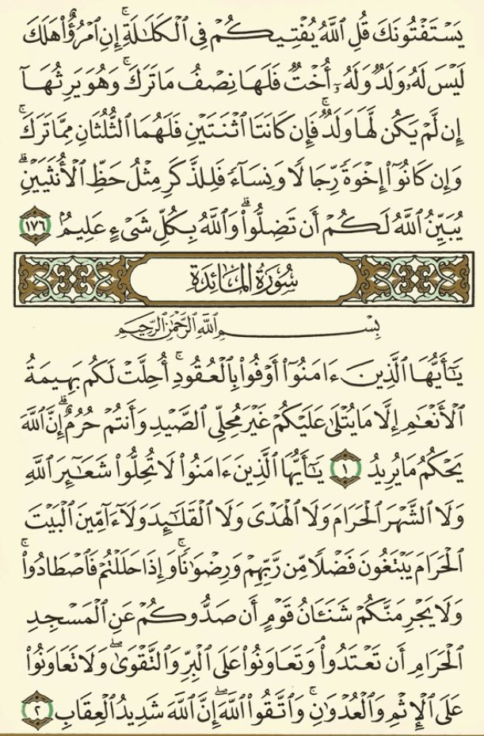
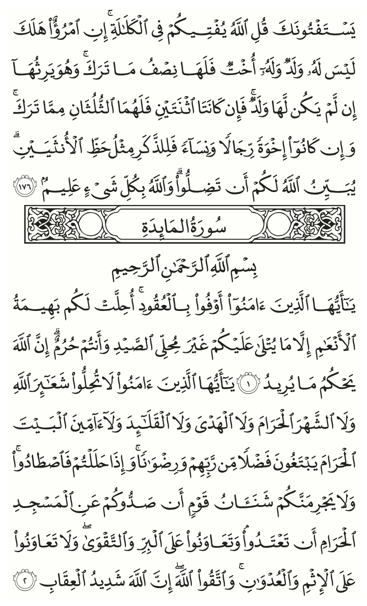

# quran-madina-html

Quran pages that look like the printed Madina Mushaf, as **real text**: selectable, searchable
and copyable, with no images. One HTML tag renders a page, a verse range or a few words:

<div class="qmh-example">
<quran-madina-html sura="2" aya="255"></quran-madina-html>
</div>

=== "HTML"

    ```html
    <quran-madina-html sura="2" aya="255"></quran-madina-html>
    ```

=== "React"

    ```jsx
    <QuranMadinaHtml sura={2} aya="255" />
    ```

=== "React Native"

    ```jsx
    <QuranMadinaNative sura={2} aya="255" />
    ```

=== "Flutter"

    ```dart
    QuranMadinaFlutter(sura: 2, aya: '255')
    ```

Every example in these docs is the library itself, rendering live.

## Why

- **Faithful to the print:** the same line breaks, the same words on each line, and lines
  justified the way a calligrapher fills them, by stretching the letters themselves.
- **Text, not pictures:** it can be selected, searched, copied, zoomed and read by screen
  readers, and a page weighs far less than a scan.
- **One tag:** no build step and no framework. Wrappers exist for [React](frameworks/react.md)
  and [Flutter](frameworks/flutter.md).
- **Three prints:** the 1441H and 1405H Madina Mushaf and the 15-line IndoPak, at any size.
- **Word-level control:** show any word range, mark words, and emphasise single letters,
  for teaching or for pointing at a mistake.

## Next to the print

Page 106 of the printed 1405H Madina Mushaf, and the same page rendered with
`data-layout="1405H"`: the same lines, as live text.

<div class="qmh-gallery">
<figure><figcaption>Printed Mushaf</figcaption></figure>
<figure><figcaption><code>page="106"</code></figcaption></figure>
</div>

## Where to go next

- [Getting started](getting-started/index.md): add it to a web page, a React app or a Flutter app.
- [Guide](guide/index.md): pages and verses, layouts, words, highlighting, letters, styling.
- [Reference](reference/index.md): every attribute and option in one place.
- [Quran reader](https://tarekeldeeb.github.io/quran-madina-html/reader/): the whole Mushaf, two
  pages at a time, in any of the three prints.
- [Live demo](https://tarekeldeeb.github.io/quran-madina-html/demo/index.html) with a playground.
