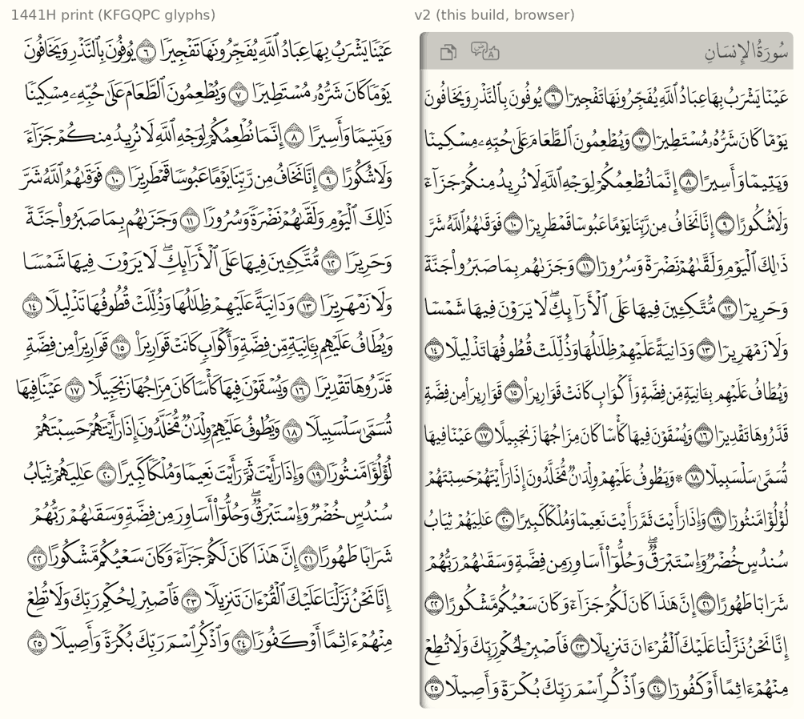
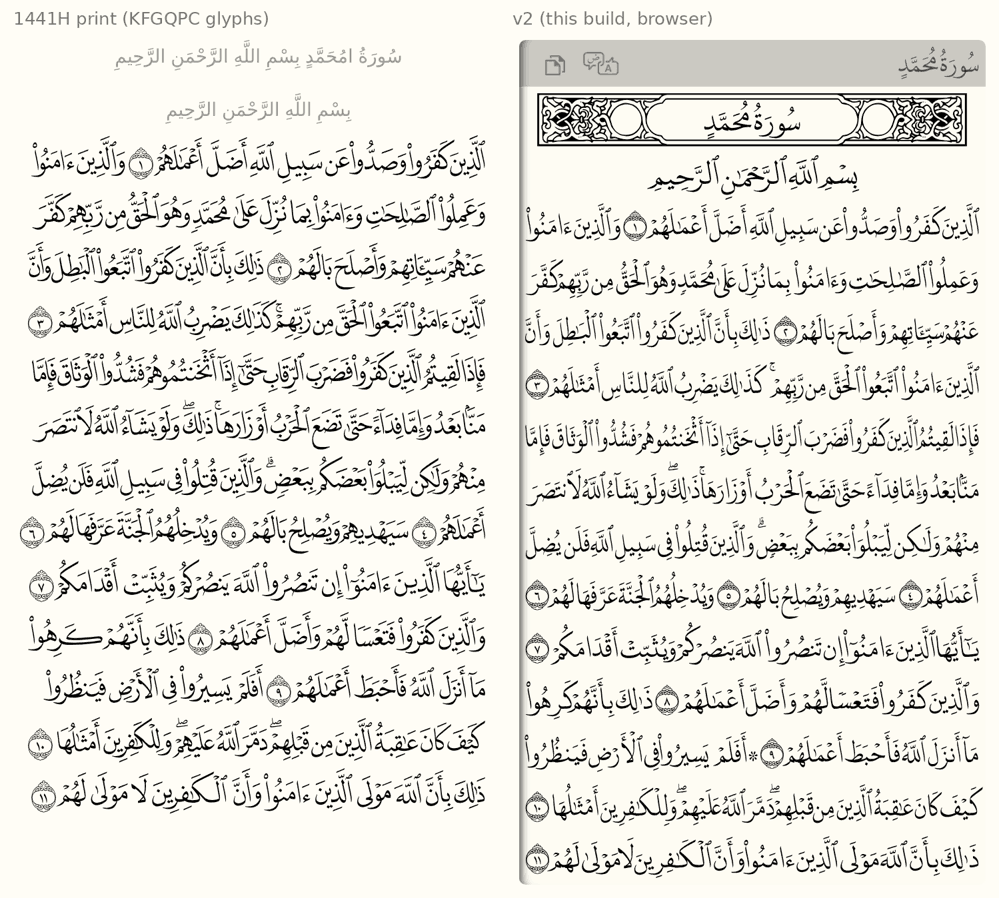

# v2.0 — design decisions

## Layouts

| | 1441H (default) | 1405H (option) | IndoPak 15-line (option) |
|---|---|---|---|
| Font | DigitalKhatt New Madina (`hb/madina.otf`) | DigitalKhatt Old Madina (`hb/oldmadina.otf`) | DigitalKhatt IndoPak (`hb/indopak.otf`) |
| License | OFL 1.1, no Reserved Font Name | OFL 1.1, no Reserved Font Name | OFL 1.1, no Reserved Font Name |
| Line breaks | **KFGQPC 1441H print** (`src/db/v2/data/print-1441H-lines.json`, see below) | DigitalKhatt `quran_text_old_madinah.ts` (MIT); same breaks as the v1 `Madina05` DB | DigitalKhatt `quran_text_indopak_15.ts` (MIT) |
| Line width | 16200 font units | 16400 font units | 16400 font units |

IndoPak was added at the user's request; its text and pause marks will need
their own check against Tanzil (IndoPak spelling conventions differ).

The two layouts break lines differently on ~37% of lines (5658 of 9046 lines
have the same word count).

## Text: Tanzil is the source

Tanzil stays the authoritative text. The DigitalKhatt texts are used **only
for line breaks**. Tanzil words are converted at build time to the encoding the
fonts expect (`src/db/v2/tanzil_encoding.py`): decomposed hamza with U+034F,
no tatweel before dagger alef, ى → ي where it carries a vowel or follows kasra,
`۝` + digits for aya numbers, ۞/۩ attached to their word, and the open tanween
ࣰ ࣱ ࣲ derived by the tajweed rule (open before idgham/ikhfa letters, stacked
before throat letters and hamzat wasl, plain vowel before the iqlab meem).

Checked over the whole Quran (`src/db/v2/validate_encoding.py`):

| Reference | Identical tokens | Pause marks only | Other |
|---|---|---|---|
| 1405H text | 84,112 / 84,116 | 1 | 3 (DigitalKhatt spacing quirks around ۞ ۩, v1 bug below) |
| 1441H text | 83,764 / 84,116 | **352** | 1 (v1 bug below) |

- Every *letter* of Tanzil matches both prints. The 1441H print revised 352
  **pause marks (waqf)**; Tanzil keeps the earlier ones. **Decision:** the
  1441H layout uses the 1441H print's pause marks
  (`tanzil_encoding.apply_pause_marks`, aligned on text without marks; letters
  and vowels always stay Tanzil's). Result: 84,116 / 84,116 tokens identical.
- **v1 bug found:** page 254 (13:37) — the v1 DB has no ﴿٣٧﴾ marker and puts
  "مَا" on line 7 instead of line 6.

## Stretching letters in browser text: position features in the font

Per-letter stretching (DigitalKhatt's `cv01`/`cv02`/`cv10`–`cv18`) cannot be
done with nested spans: joining breaks (`img/page3-per-letter-spans-broken.png`),
and even with ZWJ at span edges kerning and cursive attachment are lost
(words drift up to 12px at 40px).

So the fonts are extended (`src/db/v2/font_patch.py`):

1. At build time HarfBuzz justifies each line with per-letter features
   (`justify.justify_line`), exactly like DigitalKhatt's own justifier.
2. Stretching never changes a word's glyph count (verified on all 19,482
   stretched words of 1441H and 25,204 of 1405H), so each stretched word is
   recorded as "glyph at position k becomes glyph g′".
3. The font gets one AlternateSubst lookup (g → its stretched variants) and
   features `jp01`…`jpNN`: `jpKK` swaps the glyph at position KK of the word,
   the CSS value picking the variant. These lookups run after all others, so
   GPOS (kerning, cursive, marks) sees exactly HarfBuzz's glyphs.
4. Each word is one span: `…`
   (since the CoreText finding below, written `"q043"`: an on/off twin of the same feature).

Results (Chromium, 40px): every word within **0.015px** of HarfBuzz, every
line within **0.08px** of its target, on 1441H pages 3, 50, 300 and 1405H page 3.
See `img/1441h-page3-jp-chromium.png`.

The patched fonts are renamed (OFL good practice) and rebuilt with the DB,
since the alternate lists depend on the corpus.

## Open

- Firefox (not installable in this workspace): untested; it shapes with HarfBuzz, like Chrome.
- Safari/CoreText (iOS 18, measured with `demo/diag.html`): custom features work, but CoreText
  ignores a feature's *value* in the nested AlternateSubst and always takes alternate 1, so
  stretched words came out up to 0.76em off. Fixed by giving the font one on/off feature per
  (position, alternate) pair (`q043` = `jp04` value 3); the runtime emits those everywhere.
  Afterwards every stretched word is within a pixel of Chrome. Left: two words with a kashida
  carrying hamza plus CGJ (`لِـٔ͏َادَمَ` +0.22em, `يَٰٓـٔ͏َادَمُ` −0.11em on page 6) still differ.
  Fixed in 2.2.2, see below.

## Joins on CoreText (2.2.2, `src/db/v2/cursive_fix.py`)

On iPhone, letters showed small vertical steps at joins (every 2.x release; the DigitalKhatt
fonts, not the stretch features). Two causes, found with test pages on a device:

- **Mixed cursive directions.** The fonts join letters with several `curs` lookups, one flagged
  RightToLeft. HarfBuzz reverses attachment chains to reconcile the two directions; CoreText
  does not, and the heights at those joins come out wrong. With every cursive lookup in one
  direction the joins are right on iPhone, but each chain then hangs from its first glyph, and
  about 1,400 words of 1441H sit up to 0.2em off the line in every browser.
- **CGJ inside a joint.** The encoding's CGJ between a hamza and its vowel (`ـٔ͏َ`) is a base
  glyph; HarfBuzz skips it (default ignorable), CoreText keeps it between the letters it joins.

The fix, applied by the build (and once to the 2.2.1 DBs):

1. Every cursive lookup loses RightToLeft.
2. The font gets GPOS position features `z
<dd>`, run before the joining: shift the glyph at
   buffer position p by dd units. Shifting a chain's first glyph moves the chain. For each word
   (and each of its stretch settings) the build walks the base glyphs in reading order; a glyph
   that sits off its HarfBuzz height is a chain root, and gets what it lacks.
3. CGJs leave the text except where HarfBuzz needs them to keep mark order (a few contexts:
   sukun + sakta, dagger alef + hamza, ...); removing the others changes no shaping.
4. The DB carries the tags: in `f` with the stretch features (`jp04=3,z1ip`), in `g` for
   unstretched renders when they differ, in `nf` for sura names (header).

Every word form of the three layouts (about 33,000 each) is verified to shape exactly as with
the original font (glyphs, advances, offsets); the build fails otherwise. 1441H needs 388 shift
features, 1405H 602, IndoPak 737; the woff2 grows by ~6-12 KB, the DBs by ~15% gzipped.
- Pages 1-2, sura titles, basmala lines.

## Runtime (Phase 4)

`<script src=".../quran-madina-html.js" data-layout="1441H">` (default `1441H`,
or `1405H`) loads `assets/db/v2/Madina-<layout>.json` and its woff2 font. A page
that sets `data-font` without `data-layout` keeps the v1 DBs.

- Every v2 line gets its row from `lines[page][line]`: width (em), centering for
  titles/basmala/narrow lines, `scaleX` for the few shrunk lines.
- Words are spans with their `font-feature-settings`; spaces are inline-block
  spans of the exact width. The words=, highlight=, error= and spacer paths all
  use the same builder (`v2AppendWords`), so selections keep the page geometry.
- Copy/paste maps the font encoding back to standard Uthmani (CGJ removed,
  hamza recomposed, open tanween → regular).
- No font-size anchors or interpolation: everything is in em.

Screenshot: `img/v2-runtime-chromium.png` (page 3, highlight/error, words=,
inline quote, page 1).

**Checked against the real Tanzil file** (Uthmani 1.1, downloaded on
2026-10-16 without marks). Its letters and vowels match the text recovered from
the v1 DB on every aya; the only difference is 17:7 لِيَسُـۥٓـُٔوا۟, where
Tanzil puts a tatweel under the small waw (now handled by
`POST_CONVERSION`). Built from that file, the 1441H DB is **byte-identical** to
the committed one.

When the Tanzil text has no pause marks (`marks=false`), the builder takes the
pause marks and the ۞ and ۩ signs from the layout's print text (they are not
in the text itself either: ۞ 199, ۩ 15). For 1441H that changes nothing, since
its pause marks come from the print anyway. For 1405H it differs in one
place, 19:38 يَأْتُونَنَاۖ, where DigitalKhatt's 1405H text has no mark. The
committed 1405H DB keeps Tanzil's mark; to rebuild it, download with marks:
`index.php?quranType=uthmani&outType=txt-2&marks=true&sajdah=true&rub=true&tatweel=true&agree=true`.

## Matching the 1441H print (replaces the "hybrid" fitting)

The first v2 pages had overlapping words and crowded lines. Compared with the
1441H print (King Fahd Complex's own QCF4 data: one glyph per word, traced
from the printed page, with the print's line breaks), three causes showed up:

1. **Line breaks.** DigitalKhatt's "madina" text breaks 1,620 of 8,802 text
   lines differently from the 1441H print. 573 of its lines start with an
   aya number; the print never does that (0 lines). Lines that gain a word
   become overfull.
2. **`shrr`.** This shrink feature overlaps letters: ٱلرِّقَابِ goes from
   2351 to 1141 units. DigitalKhatt's own renderer never uses it. v2 had put
   it on 2,333 words.
3. **Squeezed spaces.** On dense lines the print keeps its gaps and writes the
   *words* narrower (up to ~25%), and never touches aya numbers. v2 cut the
   spaces to 0.06 em, then scaled the whole line, aya numbers included.

The font size was not the cause: the DigitalKhatt font at `z = 0.92` is
close to the print (0.96 would match it exactly).

**What changed:**

- **Line breaks** come from the print. `extract_print_lines.py` reduces the
  page data of the [`quran-qcf4`](https://www.npmjs.com/package/quran-qcf4)
  package (JSON: MIT) to the first and last token of each line, stored as
  `sura:aya:index` with the print's separate ۩ folded into its word. No
  glyphs or text are kept. Narrow lines (pages 1-2, some sura ends) take the
  print's width. The 1405H layout keeps DigitalKhatt's breaks, which already
  match the 1405H print.
- **Gaps follow the print.** Gaps are measured ink to ink, band by band
  (`ink.py`: a word's leftmost and rightmost ink per 20-unit band), as a
  share of the line width. Values are from every 3rd page of the print:

  | gap | p5 | median | p95 | may move |
  |---|---|---|---|---|
  | word / word | 0.0058 | 0.0109 | 0.0181 | 0.55–1.65× |
  | word / ۝N | 0.0095 | 0.0102 | 0.0201 | 0.93–1.9× |
  | ۝N / word | 0.0078 | 0.0086 | 0.0097 | 0.91–1.13× |

  A space can be negative: the word boxes then overlap, but their ink never
  does.
- **Lines are fitted with the words** (`justify.fit_line_print`):
  - *Loose line:* gaps open up to 1.2×, then letters stretch (DigitalKhatt's
    kashida and alternates, unchanged), then the gaps take the rest.
  - *Dense line:* gaps tighten within their range, then the words get
    narrower (`c`, a `scaleX` on each word span, down to 0.8, never on aya
    numbers). Only then is the whole line scaled (`x`).
  - `shr1`/`shrr` are no longer used.

| 1441H, every 10th page | word pairs touching | closest gaps (p1) | word gaps median / p95 |
|---|---|---|---|
| print | 5 of 6,690 | 0.0050 | 0.0112 / 0.0188 |
| v2 before | **100** of 6,697 | **0.0000** | 0.0106 / **0.0281** |
| v2 now | 2 of 6,689 | 0.0056 | 0.0138 / 0.0181 |

"Touching" means within 1px at a 1600px line. 1441H now has 1,438 lines with
narrowed words (277 below 0.9) and 20 line-scaled lines; 1405H has 885 and 7.
`test/v2_layout_test.py` checks that every line has the print's words, that
no line starts with an aya number, that no word uses `shr*`, and the closest
gaps on sample pages.

